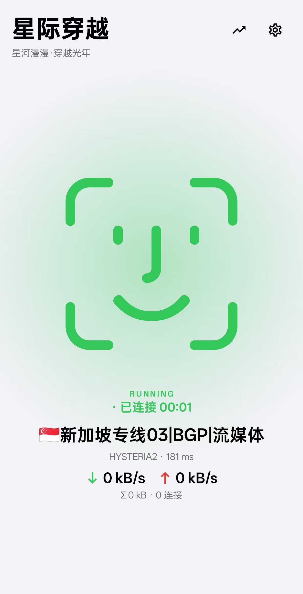

<div align="center">


# 星际穿越 · interstellar

**星河漫漫， 穿越光年。**

Android 7.0+ · v0.5.2 · Kotlin + Jetpack Compose

</div>

Android 上的**三内核**代理客户端（sing-box / mihomo / Xray 一键切换）。UI 采用「航空航天玻璃 + 任务控制台」设计语言（参考 satelite-proxy）：深空底色、玻璃拟态卡片、环境光晕、马卡龙主题色、状态驱动 Hero、遥测仪表网格与底部玻璃 dock。

<div align="center">



</div>

## 功能

### 内核（三选一，运行中可切换）

- **sing-box 1.14**：进程内 `libbox.aar`（gomobile，四 ABI），`CommandClient` 本地套接字热切换/测速/日志，无需重启
- **mihomo (Clash Meta)**：sidecar 子进程（自编译 `cmfa` 标签规避 packages.xml 权限问题），Clash REST API 热切换、组测速、活跃连接管理、流量统计
- **Xray v26**：官方安卓二进制 sidecar（arm64/x86_64），支持 ss/vmess/vless/trojan/socks/http/wireguard/**hysteria2**；切节点 = 重生成配置重启生效
- **hysteria2 全量参数**：混淆区分 `salamander` / `gecko`（1.14 / 1.19.26 起的内核才支持 gecko），并支持 `mport` 端口跳跃 + `hop-interval`；sing-box 走 `server_ports`/`hop_interval`，mihomo 走 `ports`/`hop-interval`，Xray 走 `quicParams.udpHop`
- **TUN 桥接**：sidecar 内核统一走 hev-socks5-tunnel（JNI 进程内库）把 VPN TUN 桥到本地 socks 口，规避子进程 fd 继承限制（v2rayNG 同款方案）
- **防环**：节点服务器 IP + 国内 DNS 自动排除出 VPN 路由；GEOSITE/GEOIP 数据库随 APK 打包（mihomo 用 metadb，Xray 用 v2fly dat），冷启动无需联网下载
- **DNS**：sing-box typed DNS；mihomo fake-ip + sniffer + proxy-server-nameserver；Xray 劫持 53 → 内置 DNS（国外 DoH 走代理 / 国内直连），不依赖节点 UDP 转发

### 应用更新

- **应用内更新**：设置 → 版本 点一下即查；启动时也会静默查一次（可在同一处关掉）。有新版时版本行直接显示 `0.7.0 → 0.8.0`，点开弹窗看更新说明 → 下载（带进度，关掉弹窗也继续下）→ 拉起系统安装器
- **双源回退**：先查 GitHub Releases API（按 ABI + flavor 精确匹配资产，约 30 MB）；国内直连 GitHub 基本不通，失败后自动退到自建镜像 `https://cctyt.de5.net/dl/netproxy-latest.json`（universal 包，约 113 MB）。两源都失败时给出「浏览器打开下载页」的出口
- **不额外设代理**：更新请求不显式走代理（和订阅更新一致）。VPN 开着时会被自己的隧道接管——走当前节点，节点正常时 GitHub 反而更容易连通，但下载会消耗节点流量；节点全挂时先关掉代理再检查
- **安装授权**：Android 8+ 首次安装会跳到「安装未知应用」授权页（`REQUEST_INSTALL_PACKAGES` + `ACTION_MANAGE_UNKNOWN_APP_SOURCES`），授权后回来再点一次「安装」
- **完整性**：镜像源 manifest 带 sha256，下载完先校验再交给安装器；APK 通过 `FileProvider` 以 `content://` 暴露，不落公共存储

### 订阅

- **多格式导入**：Clash YAML / 分享链接（ss·vmess·vless·trojan·hysteria2·tuic·anytls…）/ Base64 自动嗅探
- **导入体验**：URL（伪装 clash-verge UA，解析 `subscription-userinfo`）/ 文本导入，进行中显示进度条且可取消，失败原因在对话框内直接展示并保留输入
- **扫码导入**：订阅页右上角扫码 / 「添加订阅」里的「扫码」，相机取景自动识别（CameraX + ZXing，**不依赖 Google Play 服务**）；支持订阅地址、`shadowrocket://add/sub://`、`clash://install-config?url=`、`sub://`、节点分享链接、整段 Base64 订阅；带手电筒与「从相册选择」，权限被拒时给出去设置的指引
- **流量显示**：剩余流量 / 到期信息
- **自动更新**：WorkManager 定时拉取（1/6/12/24h），运行中按内核热重载
- **Mix 多订阅合池**：手动勾选要合并的订阅，节点合并为单一池并标注来源

### 节点

- **切换模式**：手动 / 自动（urltest）/ **智能** 三种
- **智能模式**：每 30s 实测当前出口（HTTP 204 经隧道）；延迟 >300ms 触发重选——TCP Ping 全池（<200ms 入备选）→ 实测筛选（API 内核用组测速快照，Xray 逐个切换验证）→ 择优热切换；延迟缓存持久化排序驱动下轮探测顺序；备选过少 / 无达标节点 / 筛选超时告警；首页内核区上方常驻状态行，节点页智能卡实时显示当前节点与延迟
- **URL Test 测速**：进度条 + 完成统计（节点数 / 成功 / 失败原因归类 / 最低 / P50 / P95 / 最高）；等待以内核单节点超时为基准（15s + 余量），大节点池不漏测；失败节点显示「超时」而非「未测」
- **TCP Ping**：不依赖内核直连测握手延迟，失败原因归类统计；UDP 协议（hy2/tuic/wireguard）自动跳过并提示用测速
- **协议摘要**：节点卡显示协议信息，长按详情展开完整参数与凭据（不脱敏）
- **布局与排序**：网格 / 列表双布局、延迟 / 名称排序
- **分组**：地区分组吸顶折叠；可选按国家 urltest 分组

### 路由

- **路由模式**：规则 / 全局 / 直连，首页状态胶囊只读展示、设置页切换
- **路由规则**（简易）：域名 → 直连 / 走代理 / 指定节点，Dialog 编辑，三内核语义一致
- **内置大陆分流**：geosite/geoip 随 APK 打包，大陆直连无需在线下载
- **去广告** / **局域网直连**：一键开关
- **DNS 解析覆写**：域名 → 固定 IP（hosts 语义）

### 分应用代理

- 白名单 / 黑名单两种模式，图标 + 搜索 + 批量选择 + 常用应用预置（关键字可扩展）
- 修改即时生效：sing-box 热重载 OverrideOptions；mihomo/Xray 检测到名单变化自动重建 TUN 应用

### 界面与交互

- **底部玻璃 dock 导航**：首页 / 节点 / 订阅 / 日志 / 设置，HorizontalPager 跟手拖动
- **玻璃控制台设计语言**：深空底色、半透明玻璃卡、accent 环境光晕、磨砂分段控件、深浅色跟随
- **马卡龙主题色**：六色预设，一个 accent 换肤整套 UI
- **状态驱动 Hero**：Face ID 笑脸（眨眼/呼吸/状态表情）或经典轨道双样式
- **任务控制台首页**：状态胶囊（路由模式/应用分流/切换模式，点击直达对应设置）+ 内核切换段控（sing-box/mihomo/Xray 运行中热切换）+ 遥测仪表网格（核心版本、实时流量、出口网络探测、订阅额度）+ 底部启动/切换节点按钮
- **网络探测**：多公共 IP API 竞速，经当前内核出口，显示出口 IP/地区/延迟
- **连接监控**（sing-box/mihomo）：活跃连接实时列表，单条/全部断开
- **日志页**：内核 stdout + 应用事件日志实时流，UTF-8 中文无损；右上角档位按钮循环切换「全部 → 警告+ → 仅错误 → 已关闭」。**默认关闭**（不记录、不占内存，需要排障时点一下打开，选择会记住）；选「已关闭」会把日志管道整体停掉（不订阅内核 Log、不 tail mihomo 日志、不收应用日志），不只是界面上不显示
- **通知**：常驻通知栏实时显示连接速率

## 项目结构

```
app/src/main/java/com/interstellar/proxy/
├── MainActivity.kt         # dock 导航 + HorizontalPager + 子页面栈
├── InterstellarApplication.kt
├── bg/                     # 服务层（移植自 sing-box-for-android 最小集）
│   ├── BoxService.kt       # 服务编排（CoreEngines 工厂 + pendingRestart 平滑重启）
│   ├── VPNService.kt       # VpnService.Builder / sidecar TUN（排除路由 + 分应用）
│   ├── ProxyService.kt / QuickTileService.kt / ServiceNotification.kt …
├── core/                   # 三内核抽象
│   ├── ProxyCore.kt        # 引擎接口 + CoreEngines 工厂 + CoreHost 回调
│   ├── SingBoxCore.kt      # 进程内 libbox
│   ├── MihomoCore.kt       # sidecar + Clash REST API + hev TUN 桥
│   ├── XrayCore.kt         # sidecar + 就绪探测 + hev TUN 桥
│   ├── SidecarProcess.kt   # 子进程生命周期/日志轮转/看门狗
│   ├── ClashApiClient.kt / TProxyService.kt（hev JNI）/ AppLog.kt
├── data/
│   ├── model/ subscription/          # 节点模型 / 多格式解析
│   ├── config/ConfigBuilder.kt       # sing-box JSON 生成
│   ├── config/MihomoConfigBuilder.kt # Clash YAML 生成（语义对齐）
│   ├── config/XrayConfigBuilder.kt   # Xray JSON 生成（含 hy2）
│   ├── net/（SubscriptionFetcher / NetProbe）/ Settings.kt / …
│   ├── AppUpdater.kt                 # 应用内更新（查 GitHub → 退镜像 → 下载 → 安装）
├── ui/
│   ├── AppViewModel.kt     # 状态流 + 三内核分支 + SmartSwitchEngine 接线
│   ├── SmartSwitchEngine.kt# 智能模式引擎（巡检/筛选/缓存/告警）
│   ├── ConnectionsViewModel.kt / LogsViewModel.kt / PerAppProxyViewModel.kt
│   ├── components/ pages/  # 玻璃组件 / 各页面
└── utils/                  # CommandClient / CommandTarget
```

## 构建

1. **内核二进制**（`python tools/fetch_cores.py`）：
   - **libbox.aar**：sing-box 源码 gomobile 构建（本地已含于 `app/libs/`，CI 按 tag 缓存重建）
   - **libmihomo.so**：mihomo 源码自编译（`with_gvisor,cmfa` 标签，四 ABI；arm64 纯 Go，其余走 NDK clang）
   - **libhev-socks5-tunnel.so**：hev-socks5-tunnel ndk-build（四 ABI，进程内 JNI 库）
   - **libxray.so**：Xray 官方安卓 release 下载（arm64/x86_64，SHA256 校验 + 镜像回退），geodata 随包解包

2. **APK**：
   ```bash
   ./gradlew assembleDebug    # 地心游记（.debug 后缀包名，与正式版共存）
   ./gradlew assembleRelease  # 星际穿越（按 ABI 分包）
   ```
   - 签名：根目录 `signing.properties`（gitignored），缺失时 release 回退 debug 签名
   - 网络受限环境可用腾讯 gradle 镜像（已在 wrapper 配置）

3. **CI**（`.github/workflows/release-apk.yml`）：推送 `v*` tag 自动编译全部 APK 并发布 Release
   - 版本统一在根目录 `version.properties`；发版改该文件后打 `v<versionName>` tag，CI 校验一致
   - sidecar 内核按版本 pin 缓存（mihomo/hev 源码编译，Xray 官方下载）
   - 正式签名需 repo secrets（`INTERSTELLAR_KEYSTORE_B64` 等），未配置回退 debug 签名

4. **同步自建镜像**（应用内更新的回退源，GitHub 直连不通时用）：
   - 从 Release 取 `interstellar-slim-universal-release.apk`，放到服务器 `dl/` 下并**重命名成带版本的名字**，例如 `netproxy-slim-universal-0.8.0.apk`
     - 文件名不带 `-latest` 的会被 `/dl/` 打上一年 `immutable` 缓存，所以必须靠版本号区分，不能覆盖同名文件
   - 更新 `dl/netproxy-latest.json`：`version`、`assets[0].size`、`assets[0].sha256`、`assets[0].url` 指向新包
     - 这个文件**必须**叫 `*-latest.json`，只有带 `-latest` 才按 1 小时缓存，换版后客户端能立刻看到

## 技术要点

- 三内核统一抽象（`ProxyCore` / `CoreHost`），UI 与内核解耦；sidecar 经 `nativeLibraryDir` exec（W^X 合规路径）
- sidecar TUN 桥：Android 子进程继承 fd 受限，hev-socks5-tunnel 以 JNI 进程内库读 TUN 转 socks5（v2rayNG 方案）
- 运行中切内核：停止 → 重生成 → 自动重启（`pendingRestart` 吸收停止竞态）
- 端口冲突自动规避：控制端口（9090）与混合入站（2080）在生成配置前各自 bind 探测，被占就换空闲端口并持久化（`ApiPort` / `LocalPort`）。内核把「端口绑不上」当致命错误 —— 一个节点都起不来，而原文只有一句英文，所以这两处都不能写死
- 证书校验：`insecure` / `allowInsecure` / `allow_insecure` / `skip-cert-verify` 全部识别，且 `1/0/yes/no/on/off` 都算数（`String.toBoolean()` 只认 "true"，`insecure=1` 会被当成 false —— 这正是自签证书节点报 `x509: certificate signed by unknown authority` 的原因）；订阅没写这个标志时，**仅当** hy2/tuic 直连裸 IP 且没有 SNI 才默认跳过校验（公共 CA 不可能给裸地址签发证书，此处校验注定失败、且身份已由拨号地址钉死），其余情况一律保持校验
- 已知取舍：sidecar 内核（mihomo/Xray）的 DIRECT 出站无法跨进程 `protect()`，「绕过大陆」下国内站点经代理出国（sing-box 不受影响）；Xray v26 移除 `allowInsecure`，自签证书节点报 TLS 错；**Xray 的 finalmask 只有 salamander，gecko 节点在 Xray 内核下会被跳过并在提示里说明**（sing-box / mihomo 均正常）
- 技术栈：Kotlin + Jetpack Compose（Material3）、kotlinx-serialization、kaml、OkHttp、WorkManager

## Roadmap

- [ ] 内置规则集定期更新（随版本发布更新）
- [ ] 智能模式参数可配置（阈值 / 巡检间隔）
- [x] 三内核切换（sing-box / mihomo / Xray）
- [x] 智能切换（巡检 → Ping 筛选 → 实测择优 → 缓存排序）
- [x] 订阅自动更新（WorkManager）
- [x] 路由规则自定义（域名 → 直连 / 代理 / 指定节点）
- [x] DNS 手动解析覆写（域名 → 固定 IP）
- [x] 玻璃控制台 UI 重设计

## 致谢

- [sing-box](https://github.com/SagerNet/sing-box) — 内核与服务层参考
- [sing-box-for-android (SFA)](https://github.com/SagerNet/sing-box-for-android) — 服务层移植参考
- [mihomo](https://github.com/MetaCubeX/mihomo) / [ClashMetaForAndroid](https://github.com/MetaCubeX/ClashMetaForAndroid) — mihomo 内核与 cmfa 构建参考
- [Xray-core](https://github.com/XTLS/Xray-core) / [v2rayNG](https://github.com/2dust/v2rayNG) — Xray 内核与 hev 桥接方案参考
- [hev-socks5-tunnel](https://github.com/heiher/hev-socks5-tunnel) — TUN→socks5 桥
